<!-- live contribution graph (GitHub colours) -->

  

<!-- contribution snake: light and dark versions follow GitHub's theme -->

  <picture>
    <source media="(prefers-color-scheme: dark)" srcset="https://raw.githubusercontent.com/Arnavtomar18/Arnavtomar18/output/snake-dark.svg" />
    <source media="(prefers-color-scheme: light)" srcset="https://raw.githubusercontent.com/Arnavtomar18/Arnavtomar18/output/snake.svg" />
    
  </picture>

  
  
  
  
  

