<!-- live contribution wave (last 31 days) -->

  

<!-- snake: light + dark versions switch with GitHub's theme -->

<picture> <source media="(prefers-color-scheme: dark)" srcset="https://raw.githubusercontent.com/Arnavtomar18/Arnavtomar18/output/snake-dark.svg" /> <source media="(prefers-color-scheme: light)" srcset="https://raw.githubusercontent.com/Arnavtomar18/Arnavtomar18/output/snake.svg" /> 
  </picture>

  
  
  
  
  

